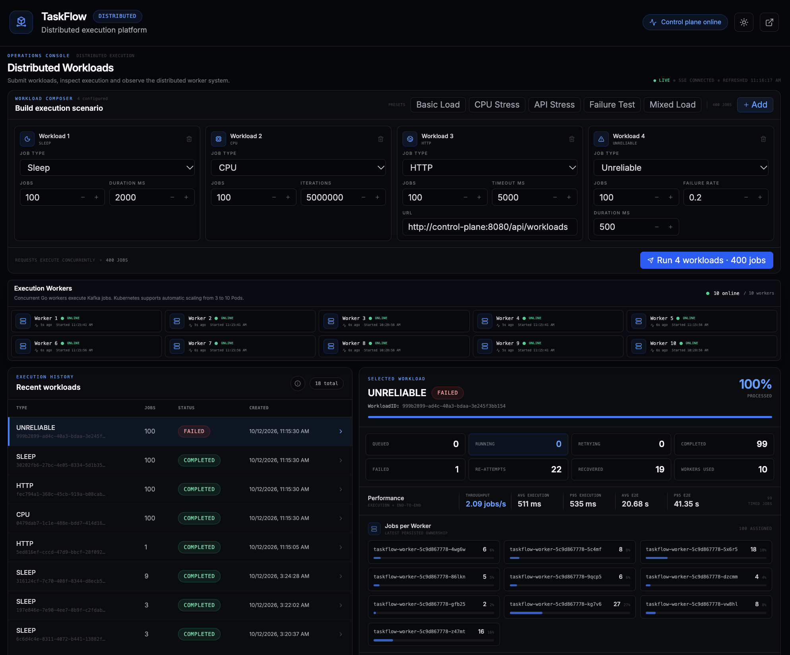

# TaskFlow

**Distributed Job Processing Platform | Java · Go · Kafka · Kubernetes**

TaskFlow is a distributed job-processing system for executing, monitoring, and recovering background workloads. It combines a Spring Boot control plane with concurrent Go workers, Kafka-based job distribution, MongoDB persistence, and Redis worker health tracking.

The platform supports automatic Kubernetes worker scaling, fault recovery, retries, and live execution monitoring through a React dashboard.



## Key Features

- **Distributed execution:** Kafka consumer groups distribute SLEEP, CPU, HTTP, and UNRELIABLE jobs across concurrent Go workers.
- **Fault tolerance:** MongoDB leases, heartbeats, retries, and job reassignment support recovery from worker crashes.
- **Autoscaling:** Kubernetes and KEDA automatically scale worker Pods between 3 and 10 based on Kafka consumer lag.
- **Graceful shutdown:** Active jobs can finish during Kubernetes scale-down without unnecessary re-execution.
- **Live dashboard:** React and Server-Sent Events display workloads, worker health, throughput, latency, and retries.

## Run Locally

### Option 1 — Docker Compose (No Automatic Worker Scaling)

**Prerequisite:** Docker Desktop running.

Runs the complete application with three Go worker containers.

```bash
./scripts/compose-up.sh
```

Dashboard: **http://localhost:5173**

To stop:

```bash
./scripts/compose-stop.sh
```

### Option 2 — Kubernetes (Automatic Worker Scaling: 3–10 Pods)

**Prerequisites:** Docker Desktop and local Kubernetes tools. On macOS, install them using Homebrew and the included script (first-time setup only):

```bash
bash scripts/k8s-prerequisites.sh
```

Start Docker Desktop, then launch TaskFlow:

```bash
./scripts/k8s-up.sh
```

Dashboard: **http://localhost:15173**

To stop safely:

```bash
./scripts/k8s-stop.sh
```

To resume without rebuilding images:

```bash
./scripts/k8s-up.sh --no-build
```

**Why two environments?** Docker Compose offers a simpler setup with fixed worker capacity by default and manual scaling support. Kubernetes adds orchestration, automatic Pod replacement, and KEDA-driven worker scaling based on Kafka backlog.

The stop scripts preserve persistent database volumes.

## Architecture

```text
             React Dashboard
                    |
             Spring Boot API
                 /      \
             MongoDB   Kafka
                        |
                  Go Workers
                        |
                Redis Heartbeats
```

**Spring Boot** coordinates jobs, **MongoDB** persists state, **Kafka** distributes work, and **Go workers** execute jobs concurrently. Redis tracks worker availability.

## Validated Behavior

| Scenario | Observed result |
|---|---|
| KEDA autoscaling | 3 → 10 → 3 worker Pods |
| Abrupt worker crash | 9/9 jobs completed; 3 recovered through reattempts |
| Graceful scale-down | 18/18 long-running jobs completed with zero reattempts |
| Worker replacement | Kubernetes automatically restores failed/deleted worker instances |

TaskFlow demonstrates **at-least-once job processing, lease-based recovery, horizontal scaling, and graceful worker lifecycle management** in a reproducible local environment.